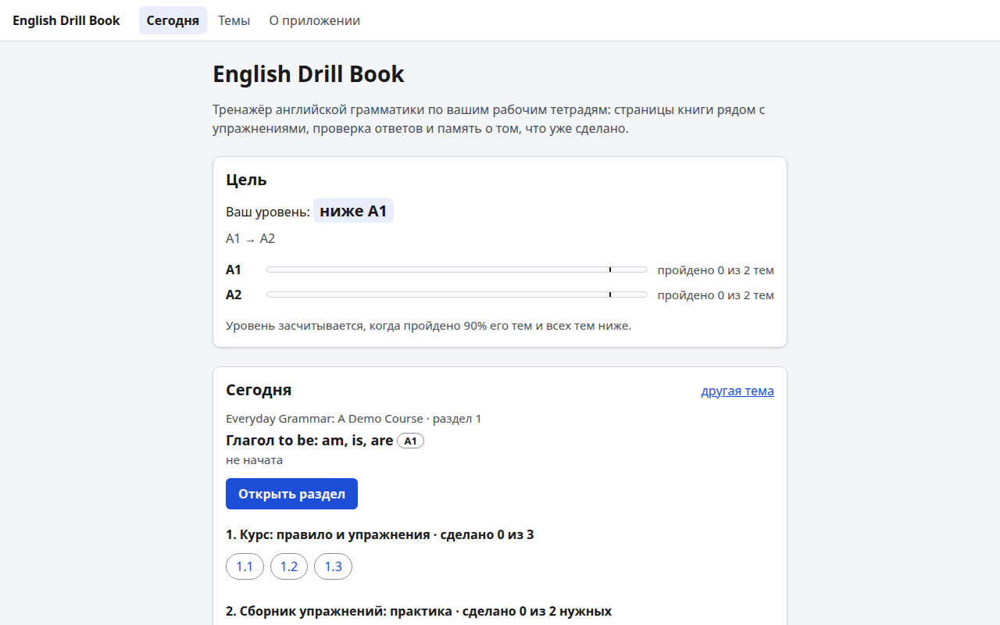

# English Drill Book

> An offline-first trainer for Russian speakers learning English from grammar workbooks: one window, pluggable content packs, automatic answer checking, progress by topic and CEFR level.

**Status: milestone 1 (the public demo) is complete; version 0.2.0 is released.** Two short demo books open in Study, pages beside exercises; answers are checked and kept in the browser; a demo program joins the two books into topics with levels; the app works offline after its first load. Milestone 2, the first product version 1.0, adds the learner's own books. See [`docs/roadmap.md`](docs/roadmap.md).

**Demo:** <https://antonchehov.github.io/english-drill-book/>, deployed from `main` on every merge.



## What it is

Grammar workbooks are good material and poor software: a PDF cannot check an answer, remember a mistake or tell you what to do today. English Drill Book is the layer on top:

- **Your own books** — the app knows the structure of the supported books and reads the learner's own PDF on their device; it ships with two short original demo books and none of anyone else's text. Own books arrive in version 1.0.
- **Exercise player** — type an answer, get it checked with tolerance for contractions, optional words and typos.
- **Program** — an ordered path of topics with CEFR levels, each topic tied to its unit in a grammar course and to matching exercises in other books; the app picks today's topic and computes your current level from what you have actually completed.
- **Local-first** — no account, no server, no tracking. Progress lives in the browser and can be exported and imported.

## Content and copyright

This repository contains **only original content** written for the demo. It contains no text from any published textbook.

There is no textbook material in the app. It is a companion for textbooks a learner already owns: the user connects their own copies, the answers are extracted on their device and sent nowhere, and the book itself is never uploaded (see [`docs/product/02-content-packs.md`](docs/product/02-content-packs.md)).

## How it is built

Specification-first, with [OpenSpec](https://github.com/Fission-AI/OpenSpec): every piece of work is a change with a proposal, a design (omitted when the work is only texts or only documentation), tasks and delta specs that the owner approves before any code is written. Coding agents implement the change as a bot identity, a separate reviewing agent, normally the same one in every round, reviews the diff in rounds until it approves the latest content, and CI refuses a pull request that lacks the evidence. Another agent then tests the built app against acceptance scenarios that the implementing agent has never seen.

The owner is responsible for the specification, the architecture, the process and acceptance; agents do the implementation, the review and the validation. [`docs/how-it-works.md`](docs/how-it-works.md) is a one-page summary.

The full process, the roles and its honest limits are in [`docs/process.md`](docs/process.md); the invariants enforced on every change are in [`docs/constitution.md`](docs/constitution.md).

## Stack

Vue 3, TypeScript, Vite, Vitest, Playwright, oxlint; deployed as a static PWA. Reasons are recorded in [`docs/decisions/`](docs/decisions/).

## Commands

Node 22 (see `.nvmrc`) and pnpm through Corepack:

```sh
corepack enable
pnpm install
pnpm exec playwright install chromium firefox webkit
```

| Command                       | What it does                                                                                                      |
| ----------------------------- | ----------------------------------------------------------------------------------------------------------------- |
| `pnpm dev`                    | development server with hot reload                                                                                |
| `pnpm build`                  | production build into `dist/`                                                                                     |
| `pnpm preview`                | serves the production build at <http://localhost:4173/>                                                           |
| `pnpm check`                  | types, lint, formatting, OpenSpec validation, requirement traceability, dependency advisories                     |
| `pnpm test`                   | unit tests                                                                                                        |
| `pnpm test:coverage`          | unit tests with the coverage thresholds of `src/domain`, without the speed test                                   |
| `pnpm test:speed`             | the speed test of the checker (CHK-014), without coverage instrumentation                                         |
| `pnpm e2e`                    | builds, then runs the end-to-end tests on Chromium, Firefox and WebKit; `PREVIEW_PORT` moves the preview off 4173 |
| `pnpm size`                   | initial JavaScript and CSS of the last build against the budgets; writes `metrics.json`                           |
| `pnpm lhci`                   | Lighthouse on the last build, mobile profile                                                                      |
| `pnpm screenshots`            | screenshots of the last build: every view, both themes, two widths, into `screenshots/`                           |
| `pnpm verify`                 | `check`, `test:coverage`, `test:speed`, `e2e`, `size` and `lhci` in turn: the gates CI runs, locally              |
| `pnpm format`                 | formats the code with Prettier                                                                                    |
| `pnpm commitlint --from main` | checks the messages of the branch's commits                                                                       |
| `pnpm review:hash <change>`   | the hash of the diff a review reads, for its line `Reviewed:`; fetches `main` first                               |

On every pull request CI runs the same gates, publishes screenshots and numbers in a comment and checks the evidence the constitution asks for (C-18); see `.github/workflows/`.

## Licence

Code: [MIT](LICENSE). The demo books and other original content: [CC BY 4.0](https://creativecommons.org/licenses/by/4.0/).
