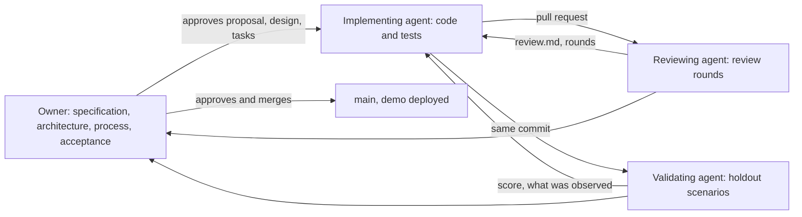

# How it works

English Drill Book is built by one owner and several agents, each with a fixed role and a fixed view of the repository. The owner decides and accepts; agents write, review and validate. Nothing reaches `main` without the owner's approval of the pull request.

## One change

1. The owner names a slice from the [roadmap](roadmap.md); the assistant drafts an OpenSpec change (proposal, tasks, a design unless it is small or only texts or documentation) and the owner approves it. No code before that.
2. The implementing agent works through the tasks, with tests that name the requirement IDs.
3. CI runs the gates of the [constitution](constitution.md) and checks the evidence of the pull request.
4. A reviewing agent with a fresh context reviews in rounds; a validating agent drives the production build against scenarios the implementer never sees.
5. The last commit archives the change; the owner merges; the merge deploys the demo.

The full process, who reads what and its honest limits are in [`process.md`](process.md).

## Numbers

| What | Value | Where |
| --- | --- | --- |
| Constraints of the constitution | 19, each with its measurement | [`constitution.md`](constitution.md) |
| Requirements with an ID in the product description | 113 | [`product/`](product/) |
| Requirements in the living specification, each named by a test | 71 (2026-11-26) | `openspec/specs/`, `pnpm check` |
| Coverage of `src/domain` | at least 95 % lines and branches | C-10 |
| Initial JavaScript and CSS | at most 120 kB and 20 kB gzip | C-06 |
| Lighthouse, mobile | performance at least 90, accessibility at least 95 | C-06, C-07 |
| Checking one item | under 5 ms | C-06, CHK-014 |
| Checks of a pull request | within 4 minutes | C-19 |
| Artifact limits | proposal 300 words (small) or 400 (large), design 1 000, tasks 300 | [`process.md`](process.md) |
| Validation | every scenario of the milestone averages at least 0.9 over three runs | [`process.md`](process.md) |
| Review | rounds 1 and 2 fix or decline every finding; from round 3 only critical findings are fixed | [`process.md`](process.md) |

Technical debt is kept in [`tech-debt.md`](tech-debt.md); the reasons for the stack are in [`decisions/`](decisions/).
